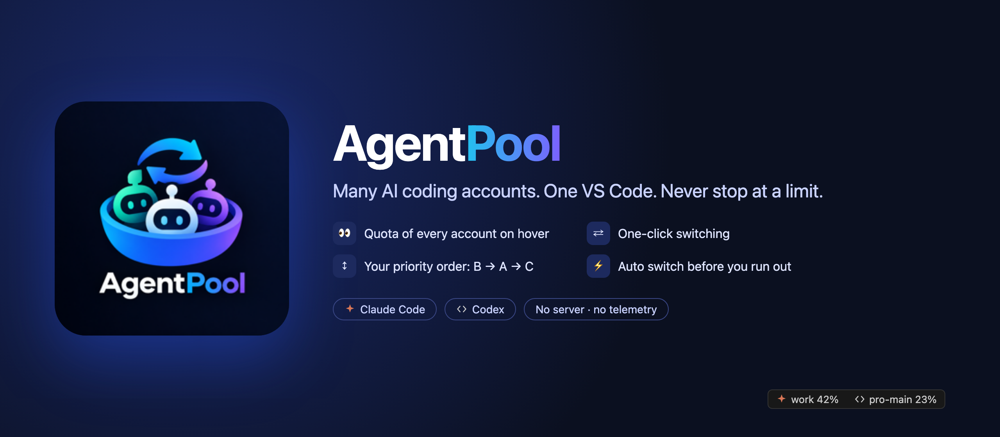
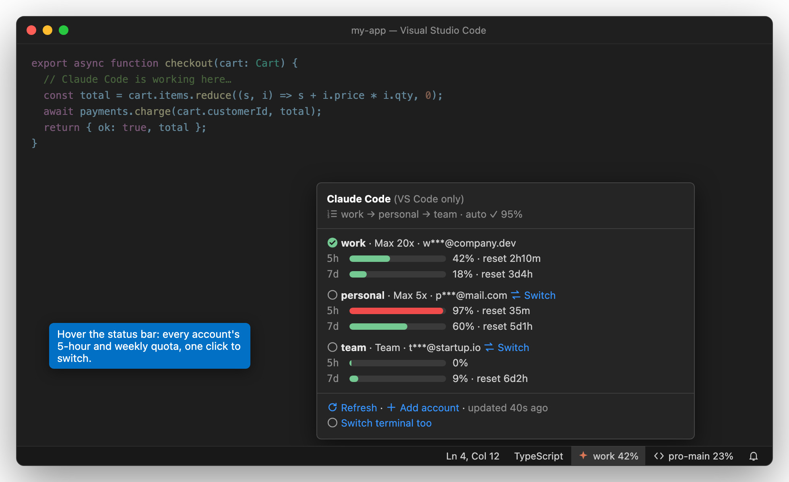
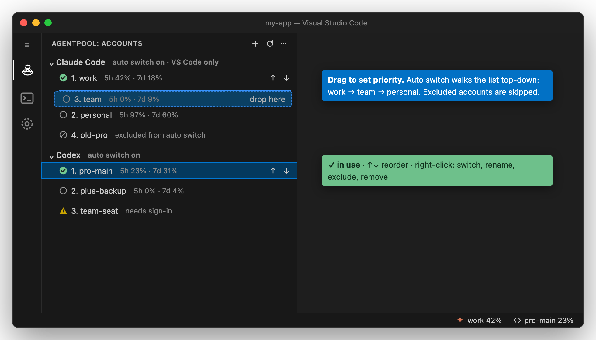
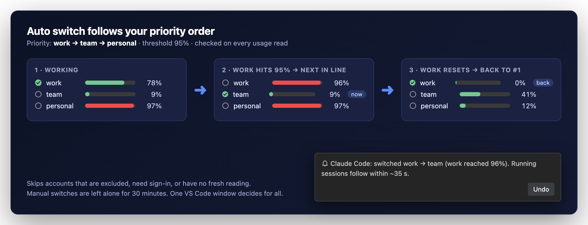
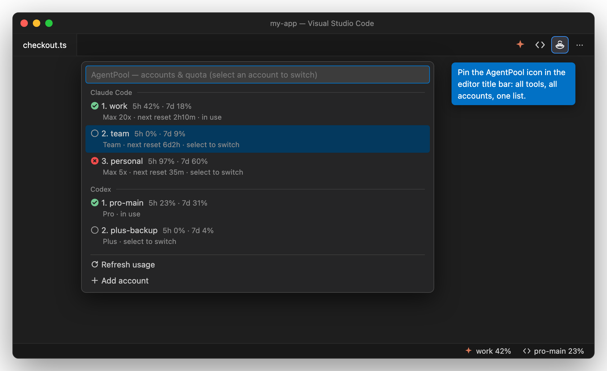
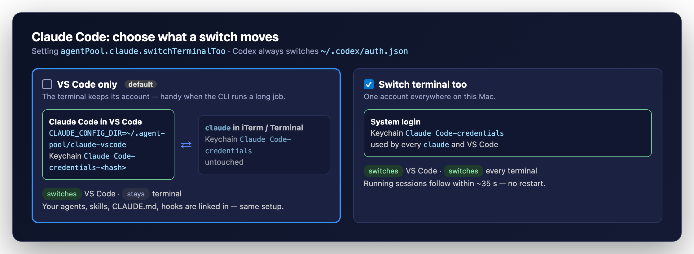

<p align="center"></p>

<p align="center">
  <a href="https://marketplace.visualstudio.com/items?itemName=TranHoaiHung.agent-pool"></a>
  <a href="https://marketplace.visualstudio.com/items?itemName=TranHoaiHung.agent-pool"></a>
  <a href="https://marketplace.visualstudio.com/items?itemName=TranHoaiHung.agent-pool&ssr=false#review-details"></a>
  <a href="https://github.com/TranHoaiHung/agent-pool"></a>
  
  
  
</p>

# AgentPool — AI Account Switcher

One account switcher for your Claude Code and Codex subscriptions, inside VS Code.

> If AgentPool saves you from a usage limit, please **[⭐ rate it on the Marketplace](https://marketplace.visualstudio.com/items?itemName=TranHoaiHung.agent-pool&ssr=false#review-details)** and **[star it on GitHub](https://github.com/TranHoaiHung/agent-pool)** — it helps other developers find it.

Manage several **Claude Code** and **Codex** accounts in VS Code:

- **Hover** the status bar to see every account's quota (5-hour, weekly, per model) and reset times.
- **Switch** with one click from the tooltip, the editor title icon, the AgentPool view, or `AgentPool: Switch account`.
- **Priority order**: drag accounts in the AgentPool view (or use ↑/↓). Auto switch walks this order, e.g. B → A → C.
- **Auto switch** before the account in use runs out (default 95%), and back to a higher-priority account once it has room again.

## How it looks

### Quota of every account, on hover



### Your priority order, by drag and drop



### Auto switch before you hit the limit



### All tools, all accounts, one list



## Quick start

1. **Install** AgentPool. It saves the Claude Code / Codex accounts you are already signed in to, and the status bar shows their quota right away.
2. **Add account** (＋ in the AgentPool view, or the welcome message) for each other account. It signs in through an isolated login in a terminal + your browser; the account in use is untouched. No CLI to install: AgentPool uses the `claude` / `codex` that ships with the official extensions.
3. **Drag** accounts into the order you want. Done — hover the status bar to watch quotas; auto switch handles the rest.

## Settings

| Setting | Default | What it does |
|---|---|---|
| `agentPool.autoSwitch.thresholdPercent` | 95 | Switch away at this share of any limit (50–100). Also: `AgentPool: Set auto-switch threshold`, or click the % in the tooltip. |
| `agentPool.autoSwitch.enabled` | on | Auto switch on/off. |
| `agentPool.claude.pollIntervalSeconds` / `agentPool.codex.pollIntervalSeconds` | 300 | How often the account in use reads its quota (halved near the threshold). |
| `agentPool.idlePollMinutes` | 30 | How often accounts not in use read their quota. |
| `agentPool.claude.switchTerminalToo` | off | Switch the terminal's `claude` too (see below). |

To remove an account: 🗑 on its row in the AgentPool view or in the quick view, or `AgentPool: Remove account`.

## Claude Code: switch scope



| Setting `agentPool.claude.switchTerminalToo` | What a switch changes |
|---|---|
| off (default) | Only Claude Code **inside VS Code**. It gets its own `CLAUDE_CONFIG_DIR` (`~/.agent-pool/claude-vscode`, Keychain item `Claude Code-credentials-<hash>`). `claude` in iTerm/Terminal keeps its account. |
| on | The system login (Keychain `Claude Code-credentials`): every `claude` in every terminal **and** VS Code. |

The VS Code slot links your `~/.claude` items (CLAUDE.md, agents, skills, commands, hooks, settings, plugins, projects…) so your config stays the same; only the login and `.claude.json` are separate. The first switch into the slot, and switching back to the terminal's account, need one window reload. Later switches are picked up by running sessions within ~35 s.

One login is never live in two slots: both would spend the same single-use refresh token.

## Codex

The login is `~/.codex/auth.json` (`CODEX_HOME` respected; only the `file` credential store is supported). A running Codex keeps its login until restarted, so a switch offers **Reload Window**; restart `codex` in terminals yourself.

## Adding accounts

- **Save current login**: saves the account the tool is signed in to now.
- **Add account (isolated login)**: runs `claude auth login` / `codex login` in a throwaway config folder, so the login in use is untouched.

Never use Claude's `/login` or **Log out**, or `codex login`/`codex logout` on the live config to add accounts: they replace or revoke the login in use.

## How it stays signed in

- Writes to Claude Code's slots take Claude Code's own `proper-lockfile` locks (`.oauth_refresh.lock`, `.storage-write.lock`) and re-read inside them.
- The outgoing login is always parked (saved) before anything overwrites it; a login nobody saved is enrolled automatically.
- Live logins are never renewed behind the owning tool's back; parked logins are renewed by AgentPool only.
- Only `claudeAiOauth` of Claude Code's credential document is swapped; MCP server tokens stay.

## Support the project

AgentPool is free and open source. The best ways to help:

- ⭐ **[Rate it on the VS Code Marketplace](https://marketplace.visualstudio.com/items?itemName=TranHoaiHung.agent-pool&ssr=false#review-details)**
- 🌟 **[Star the repo on GitHub](https://github.com/TranHoaiHung/agent-pool)**
- 🐞 **[Report a bug or ask for a feature](https://github.com/TranHoaiHung/agent-pool/issues)**

## Privacy

No telemetry, no server. Requests go only to Anthropic (`api.anthropic.com`, `platform.claude.com`) and OpenAI (`auth.openai.com`, `chatgpt.com`) for token renewal, identity and usage. Parked logins are kept in VS Code's encrypted SecretStorage; non-secret state in `~/.agent-pool/pool.json`.

The usage and OAuth endpoints are **unofficial** and may change. Manage only your own accounts and respect each provider's terms.

## Development

```sh
npm install
npm run typecheck && npm test
npm run build          # F5 "Run AgentPool" for an Extension Development Host
npm run package        # agent-pool-<version>.vsix
docs/screenshots-src/render.sh   # re-render README images (mockups with fictional data)
```

Ideas and measured facts from
[claude-account-switcher](https://github.com/KrzysztofZander/claude-account-switcher) (MIT) and
[pitboard](https://github.com/datlechin/pitboard) (Apache-2.0).
